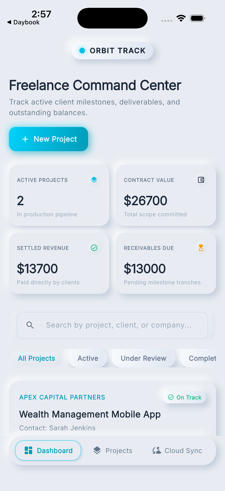
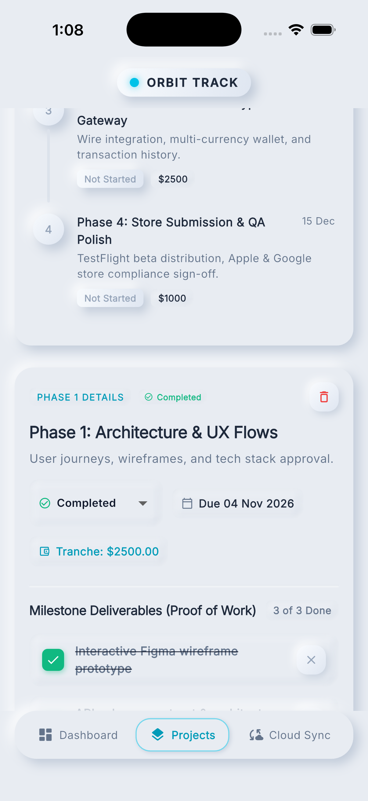
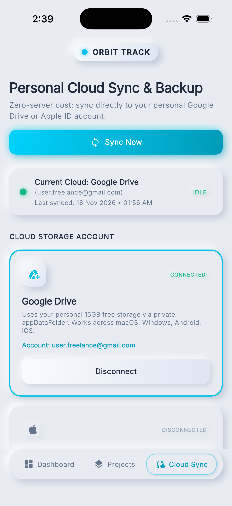
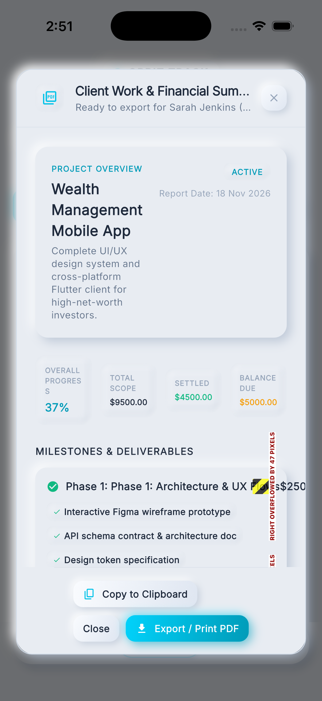

# OrbitTrack — Project & Milestone Tracking Suite

  

> **OrbitTrack** is a high-precision, cross-platform client and milestone tracking system engineered for independent software engineers, consultants, and digital product studios. 
> 
> Featuring a bespoke **Neumorphic (Soft UI)** design system and a zero-server client-side vault architecture, it combines tactile aesthetics with offline-first data sovereignty.

---

## 🌟 Executive Overview

Independent professionals and boutique studios face constant friction tracking asynchronous deliverables, phase sign-offs, and payment tranche settlements across multiple concurrent clients. 

OrbitTrack provides an integrated command center for monitoring pipeline health, verifying proof-of-work deliverables, and generating executive client summaries in one tactile, privacy-centric application.

---

## 🎨 Neumorphic Design System (Soft UI)

OrbitTrack replaces traditional flat design with a custom-engineered **Neumorphic Surface Physics Engine**:

- **Dual Opposing Light Vector (135° Natural Illumination)**:
  - **Specular Top-Left Highlight**: `#FFFFFF` @ 95% opacity (`Offset(-5, -5)`).
  - **Ambient Occlusion Bottom-Right Shadow**: `#A6B4C8` @ 65% opacity (`Offset(5, 5)`).
- **Homogeneous Surface Physics**: All cards, tactile buttons, input grooves, and navigation capsules share the exact same substrate tone (`#E8ECF2`). Elevation and hierarchy are derived purely from light displacement.
- **Custom Inset Well Rendering**: Deeply carved input wells and progress slots rendered via native canvas layer clipping and gaussian blur filtering without bloated third-party dependencies.
- **Tactile Button Press Feedback**: Active touch tracking that dynamically depresses raised convex surfaces into physical concave cavities in `120ms`.
- **Wolt Electric Cyan Accentuation**: High-visibility cyan brand accents (`#00C2E8`) highlighting active phases, live progress rails, and primary touchpoints.

---

## 📱 Visual Showcase & Key Capabilities

  <table>
    <tr>
      <td width="50%" align="center">
        <h3>1. Freelance Command Center</h3>
         
        <em>2x2 Bento scorecard, recessed search well, embossed filter chips, and floating dock.</em>
      </td>
      <td width="50%" align="center">
        <h3>2. Milestone Roadmap & Tranche Ledger</h3>
         
        <em>Interactive pipeline rail with 3D spherical nodes, proof-of-work checklist, and payment ledger.</em>
      </td>
    </tr>
    <tr>
      <td width="50%" align="center">
        <h3>3. Personal Cloud Sync & Automation</h3>
         
        <em>Direct device-to-cloud synchronization with Google Drive and Apple ID with 3D tactile switch.</em>
      </td>
      <td width="50%" align="center">
        <h3>4. Executive Client Summary</h3>
         
        <em>1-click exportable financial status, deliverable breakdown, and print-ready summary.</em>
      </td>
    </tr>
  </table>

---

## 🏗️ Architecture & Engineering Highlights

- **Multi-Platform Native Target**: Clean cross-platform codebase targeting iOS, macOS, Android, and Windows.
- **Zero-Server Infrastructure Cost**: Operates at **$0.00 infrastructure cost**. No backend databases or cloud servers host client records or financial figures.
- **Offline-First Vault Storage**: Client files and milestone ledgers persist in local disk storage with full JSON portability (instant backup and restore).
- **Direct Cloud Sync Protocols**: Syncs directly between the device and personal cloud accounts:
  - **Google Drive**: Stored securely in the user's private `appDataFolder`.
  - **Sign in with Apple (Apple ID)**: Backed by private Apple CloudKit containers for cross-platform synchronization.
- **Strict Accessibility & Contrast Standards**: High-contrast typography (`#1E293B` on `#E8ECF2`) exceeding WCAG standards for readability across both mobile and desktop viewports.

---

## 🔒 Showcase Notice

> **Note**: This repository serves as a **public design and capability showcase** highlighting the visual architecture, engineering methodology, and UX design of OrbitTrack. 
> 
> The complete proprietary source code, application state providers, platform channels, and cloud integration pipelines are privately maintained. For inquiries or live walkthroughs, please reach out via GitHub.

